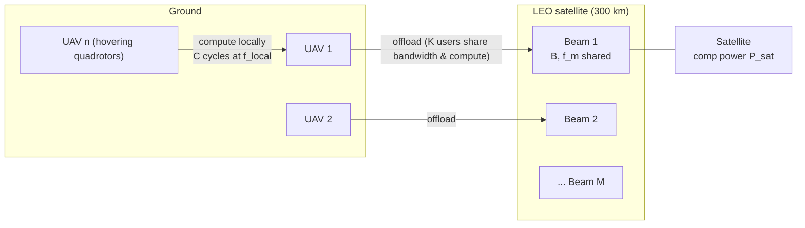
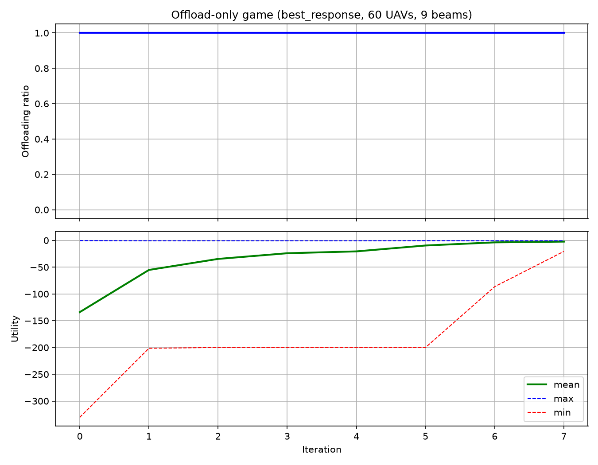
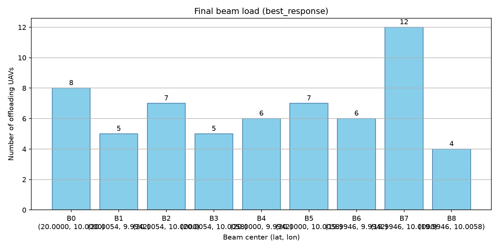
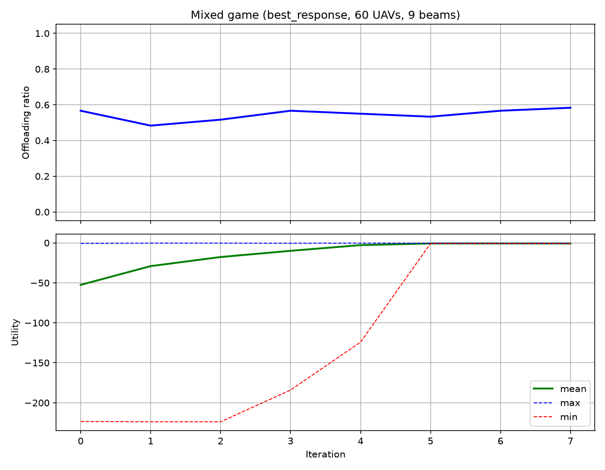
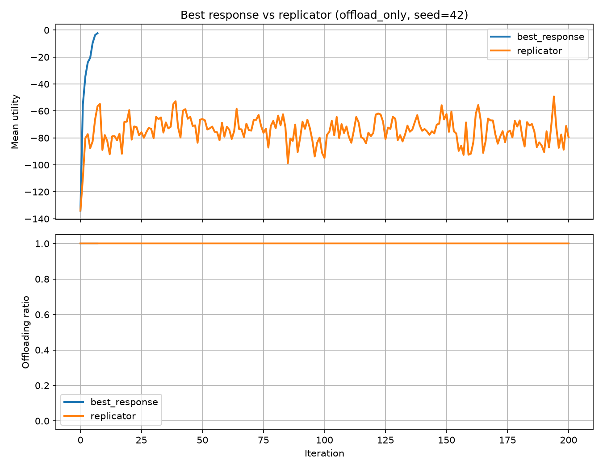

# UAV-Satellite-Beam-Game

**Game-theoretic task offloading from UAVs to LEO satellite beams — with physics-based delay/energy models, two switchable strategy-update rules, and counterfactual Nash-equilibrium verification.**

A small, self-contained simulation framework studying how a fleet of UAVs decides *where* to offload computation tasks: compute locally, or offload through one of several LEO-satellite spot beams whose bandwidth and computing resources are shared (and therefore contested) by whoever else chooses the same beam.

```
uav-satellite-beam-game/
├── config/parameters.py      # all simulation parameters in one place (SI units)
├── environment/
│   ├── uav.py                # quadrotor power model, local/offload delay & energy, normalized utility
│   └── satellite.py          # circular-orbit kinematics (Keplerian period), zero viz dependencies
├── channel/wireless_channel.py  # beam geometry -> antenna gain -> rain -> path loss -> SNR -> Shannon rate
├── game/
│   ├── scenario.py           # reproducible scenario builder (single seeded RNG drives everything)
│   ├── engine.py             # BeamSelectionGame: "best_response" / "replicator" update rules
│   ├── equilibrium.py        # counterfactual Nash-equilibrium checks + sampled price-of-anarchy
│   └── metrics.py            # welfare, offload ratio, per-beam statistics
├── experiments/
│   ├── run_offload_only.py   # pure beam-selection congestion game
│   ├── run_mixed.py          # local vs. offload game (the interesting one)
│   └── compare_rules.py      # best response vs. replicator dynamics on identical initial states
├── viz/                      # OPTIONAL 3D orbit demo (pip install .[viz3d])
├── tests/                    # 36 pytest cases: physics, channel, convergence, reproducibility
└── docs/figures/             # figures shown below, generated by the experiments
```

## Scenario



Every UAV carries one computation task (CPU cycles + data bits). It either computes locally or flies to / transmits through a satellite beam. Each beam divides both its **bandwidth** (Shannon rate `B/K`) and its **computing frequency** (`f_m/K`) among the `K` UAVs that picked it — so the beams are congestible resources and the offloading problem becomes a **congestion game**.

## The model

**Utility** (normalized negative cost, Eq. 32 of the original model):

```
U = -( α·T/T_ref + β·E/E_ref + γ·C_res/C_ref )        α=0.5, β=0.3, γ=0.2
```

The reference values `T_ref, E_ref, C_ref` are the *local-computation baseline* (local delay, local hover+compute energy, typical beam occupancy), which makes `U` directly interpretable: `U ≈ -0.8` means "comparable to computing locally"; closer to 0 is better.

| Quantity | Formula | Code |
|---|---|---|
| Local delay | `T_loc = C / f_local` | `UAV.calculate_local_computation_delay` |
| Local energy | `E_loc = κ·C·f_local²` + hover energy | `UAV.calculate_local_computation_energy`, `calculate_local_total_energy` |
| Rotor power | `P_v = P0(1+3V²/U_tip²) + mgv0√(1+V⁴/4v0⁴−V²/2v0²)`, `P_h = (d0/2)ρS_A V³` (standard quadrotor model) | `UAV.calculate_vertical_power`, `calculate_horizontal_power` |
| Offload delay | `T = T_fly + D/R + d_sat/c + C/(f_m/K)` | `UAV.calculate_offload_total_delay` |
| Offload energy | `E = P_tx·T_trans + P_sat·T_comp + P_total·T_fly + P_hover·T_hover` | `UAV.calculate_offload_total_energy` |
| Channel gain | `H = η(70π/θ_m)²·G_R·L_rain·(c/4πf_c)²d^-α` | `channel/wireless_channel.py` |
| Data rate | `R = (B/K)·log2(1+SNR)` | `WirelessChannel.calculate_data_rate` |

## Two update rules, one API

`BeamSelectionGame(update_rule=...)` switches between:

| Rule | Mechanism | Theory |
|---|---|---|
| `"best_response"` | An unhappy UAV evaluates all candidate actions (local + every beam, evaluated *with its own load included*), and switches to the best one with probability `LEARNING_RATE` if the relative improvement exceeds 1%. | Asynchronous best response with inertia — converges to a pure Nash equilibrium in congestion games. |
| `"replicator"` | Pairwise proportional imitation: pick a random peer; copy its strategy with probability `ΔU/(ΔU+scale)` when the peer is better. | Individual-level implementation of the replicator dynamics `dx_i/dt = x_i(π_i − π̄)`. |

**Nash-equilibrium verification** (`game/equilibrium.py`) is *counterfactual and side-effect-free*: for every UAV it recomputes the utility of every unilateral deviation (leave beam *j* → beam *j* loses one user and its rate is recomputed; beam *k* gains one), using the same fixed channel realization as the engine. The offload-only check is the congestion-game special case.

## What to expect

All figures below are generated by the default configuration (60 UAVs, 9 beams, seed 42):

```bash
python experiments/run_offload_only.py   # Fig. 1-2
python experiments/run_mixed.py          # Fig. 3
python experiments/compare_rules.py      # Fig. 4
```

**Fig. 1 — Offload-only game, best response.** Converges to a verified Nash equilibrium in a handful of iterations; beam loads spread out (12, 8, 7, 7, 6, 6, 5, 5, 4); sampled price of anarchy ≈ 1.0.





**Fig. 3 — Mixed game, best response.** UAVs split endogenously: 58% offload (mean offload utility −0.65 > local −0.80), beams balance at 4/4/4/4/4/4/4/4/3 — the classic congestion-game interior equilibrium.



**Fig. 4 — Best response vs. replicator dynamics** (identical initial states, offload-only mode). Best response reaches the equilibrium fast; pairwise imitation keeps churning and stalls far from any Nash equilibrium (welfare −4766 vs. −137). In the mixed game the imitation dynamics get *absorbed into the all-local state* even though that state is **not** a Nash equilibrium — a vivid illustration that the rest points of finite-population imitation dynamics form a strict superset of the NE set.



## Quick start

```bash
git clone https://github.com/futation/uav-satellite-beam-game.git
cd uav-satellite-beam-game
pip install -r requirements.txt      # numpy, matplotlib, tqdm

# run the three experiments
python experiments/run_offload_only.py --rule best_response
python experiments/run_mixed.py --rule replicator --uavs 100
python experiments/compare_rules.py --mode mixed --iterations 300

# run the test suite (36 cases)
pip install pytest && pytest

# optional 3D orbit demo (falls back to a plain blue Earth if
# viz/textures/earth_texture.jpg is absent -- drop your own texture there
# for a textured globe)
pip install .[viz3d]
python viz/orbit_demo.py --uavs 100 --speed 200
```

Everything is seeded (`config/parameters.py: RANDOM_SEED`) — two runs with the same seed produce bit-identical histories (there is a test for that). Figures are written to `results/`.

## Configuration

All knobs live in `config/parameters.py` (SI units). The most interesting ones:

| Parameter | Meaning | Play with it when... |
|---|---|---|
| `TASK_PARAMS['DATA_SIZE_BITS']` | task payload in bits (decoupled from CPU cycles) | you want offloading to be unattractive → transmission dominates |
| `TASK_PARAMS['CPU_CYCLES']`, `SATELLITE_PARAMS['comp_freq_per_beam']` | task cycles, per-beam computing split `f_m/K` | you want satellite computing to be the bottleneck |
| `BEAM_PARAMS['SPAWN_RADIUS']` | UAV spawn radius (default matches the 3×3 beam grid, 900 m) | enlarge to 3000 m → flight delay dominates and the mixed game degenerates to all-local |
| `NORMALIZATION_BASELINE` | utility reference values | rescale the three utility terms |
| `GAME['LEARNING_RATE']`, `IMITATION_SCALE` | inertia of best response / imitation temperature | tune convergence speed vs. stability |

## Modeling notes & honest caveats

- **Data size vs. CPU cycles are decoupled.** An earlier version of this code transmitted `CPU_CYCLES` bits (125 MB!), which made offloading always worse than local computing. `TASK_PARAMS['DATA_SIZE_BITS']` now exists precisely to fix that.
- **Satellite computing energy is charged to the UAV** (`P_sat · T_comp` in the offload energy): a modeling choice that makes UAVs internalize how *long* they occupy the satellite's computing resource. Set `SATELLITE_PARAMS['COMP_POWER'] = 0` if you disagree.
- **Rain attenuation is drawn once per run** and held fixed, so utilities are compared under one channel realization. Call `channel.update_rain_attenuation()` between episodes if you want time-varying weather.
- **UAVs are stationary** during a game episode; "flight delay" models repositioning into the beam footprint before transmitting, per the original model.
- The satellite sits directly above the beam cluster (sub-satellite point = big-beam center), so beams differ only through contention, not through channel quality. `environment/satellite.py` provides full orbital kinematics if you want to move it.

## References

The building blocks come from standard literature:

- Rotary-wing UAV propulsion power model (blade profile + induced + parasite power): Y. Zeng, J. Xu, and R. Zhang, "Energy Minimization for Wireless Communication With Rotary-Wing UAV," *IEEE Transactions on Wireless Communications*, vol. 18, no. 4, pp. 2329–2345, 2019.
- Offloading delay/energy decomposition and utility design follow the standard MEC literature (see e.g. Y. Mao et al., "A Survey on Mobile Edge Computing: The Key Enabler of The Internet of Things," *IEEE COMST*, 2017).
- Best response with inertia and convergence in (potential/congestion) games: D. Monderer and L. S. Shapley, "Potential Games," *Games and Economic Behavior*, 1996; log-linear learning: J. R. Marden and J. S. Shamma, "Revisiting Log-Linear Learning," *Games and Economic Behavior*, 2012.
- Pairwise proportional imitation: J. Helbing, "Interrelations between Stochastic Models of Rational Adjustment and Imitation Processes," *Physica A*, 1992; finite-population imitation dynamics: A. Traulsen, J. C. Claussen, and C. Hauert, "Coevolutionary Dynamics: From Finite to Infinite Populations," *Physical Review Letters*, 2006.
- Player-specific congestion games (pure NE existence): I. Milchtaich, "Congestion Games with Player-Specific Payoff Functions," *Games and Economic Behavior*, 1996.

## License

MIT — see [LICENSE](LICENSE).

---

## 中文简介

本仓库研究**无人机群向 LEO 卫星波束卸载计算任务**的博弈决策问题：每架 UAV 可以本地计算，也可以选择某个卫星波束卸载——但波束的带宽和计算资源按波束内用户数均分，因此这是一个**拥塞博弈**。

特色：

- **物理建模完整**：四旋翼推进功率、本地/卸载时延与能耗分解、Ka 波段波束链路（波束几何→天线增益→雨衰→路损→SNR→香农速率），全部公式与代码一一对应（见上方表格）；
- **两种可切换的策略更新规则**：异步最好响应（惯性）与成对比例模仿（复制者动态的个体级实现），`experiments/compare_rules.py` 可在完全相同的初始状态下对比二者——最好响应快速收敛到可验证的纳什均衡，而有限种群模仿动态会被"全体本地计算"吸收（该状态并非纳什均衡，是很好的教学案例）；
- **反事实纳什均衡验证**：逐 UAV 模拟"单方面偏离"后的效用（含负载变化导致的速率重算），纯函数、无副作用；
- **完全可复现**：一个种子驱动全部随机性（UAV 位置、初始策略、雨衰），同种子两次运行历史逐位一致（有测试保证）。

快速上手见上方 Quick start。运行 `python experiments/run_mixed.py` 即可复现"58% 卸载、波束负载 [4,4,4,4,4,4,4,4,3]"的混合均衡。
